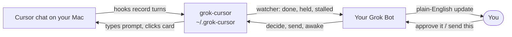
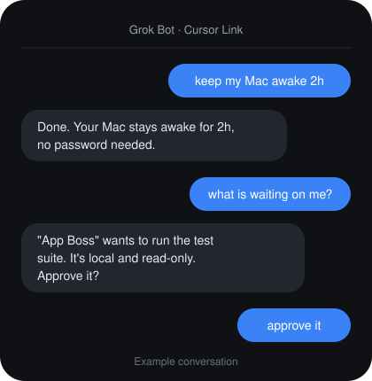
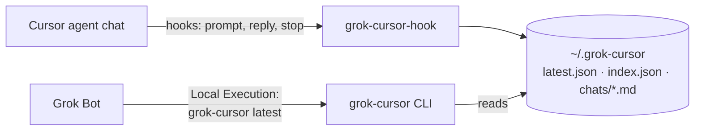

# grok-cursor

[](https://github.com/ZAKOVAI/grok-cursor-link/releases)
[](LICENSE)


## 🚀 Easiest way: use the ready-made Grok Bot

Skip the manual setup. Import the **[Cursor Link bot](https://x.ai/bot/WNOHrJKWnT4kjoUTa5gPD)**. It walks you through everything, or does it for you: install, watcher, approvals, and keep-awake.

**Give your Grok Bot eyes (and, if you want, hands) on your Cursor editor, no copy-paste.**

- **Eyes (read-only):** your bot asks "what are you working on in Cursor?" and gets the answer from your Mac.
- **Hands (opt-in, approval every time):** `grok-cursor send "prompt"` types a prompt into Cursor's chat and presses Enter, so your bot can hand work to your Cursor agent while you're away.
- Ships as a **CLI**, an **MCP server** (`grok-cursor-mcp`) and an **agent skill** (`skills/grok-cursor/SKILL.md`). Use whichever your assistant speaks.

Your Grok Bot asks "what are you working on in Cursor?" and gets the answer from your Mac in one command. It sees the active chat, the project, whether the agent is still working, and the last few turns. You don't have to export or paste transcripts.

## How it works



## What you can say to your bot

<p align="center"></p>


No slash commands. Say it in a normal sentence. Your bot runs the command on your Mac.

### Keep your Mac awake

- "keep my Mac awake 2h"
- "keep my Mac awake until 11pm"
- "add 30 more minutes"
- "is my Mac awake?"
- "let it sleep"
- "auto on" or "auto off"

Auto keeps the Mac awake while any watched chat is generating, and lets it sleep 10 minutes after the last one finishes. A time you asked for wins over auto. This does not need a password or an admin prompt.

### Check on chats

- "check <chat name>"
- "what is running?"
- "what is waiting on me?"

### Send work

- "send this to <chat>: ..."

The bot shows you the message and which chat it will go to, and sends it after you say yes.

### Approvals

The bot handles read-only checks and local work you have already approved. Anything risky comes back to you as allow or deny. Say "approve it" or "deny it".

### Shipping

A push, a release, or a deploy happens only after you explicitly say yes.

### Watcher health

- "is the watcher OK?"

## Quick start (60 seconds)

1. **Clone**

   ```sh
   git clone https://github.com/ZAKOVAI/grok-cursor-link.git && cd grok-cursor
   ```

2. **Install**

   ```sh
   ./install.sh
   ```

   This adds 5 hook entries to `~/.cursor/hooks.json` and keeps your other hooks, after backing up the original. Run `./install.sh --dry-run` first if you want to preview the change.

3. **Tell your bot.** Paste the [instruction block](#the-bot-instruction-block) into your Grok Bot's instructions. The bot needs **local shell access to your Mac**; in the Grok Bot app that's **Local Execution**.

Send one message in a Cursor agent chat, then check it with `~/.grok-cursor/bin/grok-cursor latest`.

4. **Check it.** Run `~/.grok-cursor/bin/grok-cursor selftest`. Exit 0 means hooks, gate and selectors are fine. Exit 40 or 41: see [Surviving Cursor updates](#surviving-cursor-updates).

5. **Optional: watcher pings.** To get a webhook POST when a chat finishes or waits on an approval card, copy the example config and fill in your own endpoint:

   ```sh
   cp watch.env.example ~/.grok-cursor/watch.env && chmod 600 ~/.grok-cursor/watch.env
   # edit GROK_CURSOR_WATCH_URL (https) and GROK_CURSOR_WATCH_KEY (sent as a Bearer token)
   ~/.grok-cursor/bin/grok-cursor watch install --dry-run   # logs pings only; drop --dry-run to POST
   ~/.grok-cursor/bin/grok-cursor watch status
   ```

   The launchd label defaults to `com.grok-cursor.watch`. Set `GROK_CURSOR_WATCH_LABEL` to change it.

   An undecided approval request is re-posted at most 3 times (after 60 s, 120 s and 300 s, with `"repeat": n`), and stops as soon as it is decided or expires.

## How it works



- **The hook.** Cursor runs [`grok-cursor-hook`](hooks/grok-cursor-hook) on each turn through its documented [hooks](https://cursor.com/docs/hooks). The hook appends the turn to a local markdown log, updates `latest.json` to point at your active chat, and exits in about 30 ms.
- **The reader.** Your bot runs [`grok-cursor`](bin/grok-cursor), a read-only CLI that prints the chat as compact markdown ready to drop into its context.
- **Pull, not push.** Nothing gets sent anywhere. Your bot reads the files when you ask it to.
- **Hands are separate.** Only `grok-cursor send` acts on your Mac, and only when it's called.

## What gets recorded (and what doesn't)

| Recorded | Not recorded |
| --- | --- |
| Your prompts (`beforeSubmitPrompt`) | Thinking/reasoning blocks |
| The agent's replies (`afterAgentResponse`) | Tool calls, shell output, file contents |
| Turn status: working, done, aborted, error (`stop`) | Attachment contents (only file *names*) |
| Chat open/close (`sessionStart`, `sessionEnd`) | Anything in projects listed in `~/.grok-cursor/ignore` |
| Project name, workspace path, conversation id | Cloud agents (they don't run user hooks) |

## Privacy

- **Local only.** There's no network code (`send --headless` runs the Cursor CLI, which talks to Cursor as usual). Data lives in `~/.grok-cursor`, with the directory set to `0700` and files to `0600`.
- **Nothing leaves your Mac unless your bot reads it,** and that read happens through shell access you approve.
- **Secrets are redacted before anything hits disk.** This covers:
  - API keys: `sk-…`, Stripe, GitHub, AWS, Slack, Google
  - JWTs and `Bearer`/`Basic` tokens
  - PEM private keys
  - passwords embedded in URLs
  - `.env`-style lines whose name contains KEY, TOKEN, SECRET or PASSWORD

  It's pattern-based and over-redacts on purpose. It isn't a guarantee.
- **Opt out:**
  - Put one substring per line in `~/.grok-cursor/ignore` to skip matching projects.
  - Set `GROK_CURSOR_DISABLE=1` to pause recording.
- **Bounded:**
  - Chat logs rotate at 2 MB.
  - Single turns are capped at 100k characters.
  - The index keeps the 50 most recent chats.

## Human-typed turns run without holds

The gate only gates work your assistant started. When the latest prompt in a chat was typed by you in Cursor, that chat's commands (medium **and** high risk) run without a hold or ping, until the next prompt. There is no time limit while the turn your prompt started is still running (long test runs included). After that turn ends (`stop`), the allow lasts 30 min in Away mode and 6 h in Present mode, and any new prompt decides again. Each one is logged as `human_turn_allow` in `~/.grok-cursor/events.jsonl`.

Working on this project itself: add your checkout to `~/.grok-cursor/config.json` as `"dev_roots": ["~/src/grok-cursor"]`. File edits inside a dev root may then mention `~/.grok-cursor` or `hooks.json` in their content. Writes into the data dir, the hooks file itself, shell commands and the catastrophic list are unchanged.\n\nHow it tells: `grok-cursor send` drops `~/.grok-cursor/send-pending.json` just before it submits. The `beforeSubmitPrompt` hook consumes it (within 120 s) and marks that turn `grok`; any other prompt is `human`. The stop-hook resume message (`grok-cursor: decision ...`) also counts as `grok`. A chat with no readable origin record (the hook missed the prompt, a chat from before this version) is treated like a human turn and logged as `prompt_origin_unknown`: only the catastrophic list is held. The gate only holds a turn it can prove came from `grok-cursor send` or its own resume message.

Still held in a human-typed turn (logged `human_turn_held`, then gated as high):
- `rm -r` of `/`, `~` or anything outside the workspace (`/tmp` is fine)
- force-push (`--force`, `-f`, `+ref`), any `git reset --hard`
- disk format/erase (`diskutil erase*`, `mkfs`, `dd of=/dev/...`)
- `curl|wget ... | sh` from a host not on a short install allowlist (brew, rustup, astral, bun, deno, pnpm, poetry)
- reading secret files (`.env`, SSH keys, `.pem`, `.netrc`, AWS credentials, keychain via `security`, `watch.env`)
- anything touching `permissions.json`
- cloud/data destroy: `gh repo delete`, `terraform destroy`, `pulumi destroy`, `supabase db reset`, `railway down/delete`, `vercel remove/rm`, `fly apps destroy`, `aws s3 rb`, `dropdb`, `DROP DATABASE/TABLE`

Self-protection (the agent can't read `~/.grok-cursor` or run `grok-cursor decide`, `send`, `mode` ...) applies in every turn.

## The bot instruction block

Paste this into your Grok Bot's instructions or memory:

```text
CURSOR LINK: You have local shell access to my Mac (Grok Bot app: Local Execution must be on).
When I ask about my Cursor work, run:
    ~/.grok-cursor/bin/grok-cursor latest --turns 6
Other chats: ~/.grok-cursor/bin/grok-cursor list, then ~/.grok-cursor/bin/grok-cursor show <id-or-project> --turns 6.
No hook data: ~/.grok-cursor/bin/grok-cursor transcript --project <name> --turns 6.
Decisions: ~/.grok-cursor/bin/grok-cursor summary

On a watcher event:
- Away, low risk, or suggest_always true: nothing to do.
- Away, medium: run
    ~/.grok-cursor/bin/grok-cursor decide <id> <nonce> allow|deny --reason "<why>"
  If a run card is still up, then
    ~/.grok-cursor/bin/grok-cursor approve --match <id>
- Away, high: if it is local work inside the repo, covered by a task me already approved, and git or a
  scratch container can undo it (e.g. deleting a tracked file, a throwaway local test database), decide it
  yourself with --human and say why in --reason. Otherwise tell me and wait. Always ask for: push,
  deploy, production migrate, spending, reading secrets, deletes git cannot restore.
- Only interrupt me for these, or for a real Cursor card/question. The gate pauses the command,
  so routine holds are yours to answer; do not forward them.
- Present: relay the event to me. Run approve or answer only after my yes for that exact card.
- question_needed: ~/.grok-cursor/bin/grok-cursor answer --to <chat> --option "<exact label>"
- plan_needed accept: ~/.grok-cursor/bin/grok-cursor plan --to <chat> accept
- chat_stalled: tell me. Do not click anything.

Only `decide` is on the Auto-review Custom Rule (Grok Bot Settings > General > Auto-review > Custom Rules, "Allow automatically"). That rule is AI-judged. The CLI nonce and the exact shape are the real boundary. `approve` and `answer` still need the human's per-command approval unless he adds a second rule.
Keep the Mac awake (no sudo). Durations such as 15m, 2h, 4h, or inf:
    ~/.grok-cursor/bin/grok-cursor awake 2h
    ~/.grok-cursor/bin/grok-cursor awake --until 23:00
    ~/.grok-cursor/bin/grok-cursor awake extend 30m
    ~/.grok-cursor/bin/grok-cursor awake status
    ~/.grok-cursor/bin/grok-cursor awake stop
    ~/.grok-cursor/bin/grok-cursor awake auto on
    ~/.grok-cursor/bin/grok-cursor awake auto off
Add --json to any of these for one machine-readable line.
Auto holds awake while any watched chat is generating and releases 10 minutes after the last one finishes. It never overrides a time you set yourself.

On first use, or when the user asks what you can do, send them the What you can say list from the README in plain English.

Never click a button whose label starts with Always. Never edit files under ~/.grok-cursor or ~/.cursor.
```

It works with any assistant that can run shell commands on your machine, not just Grok Bot.

## Commands

| Command | What it does |
| --- | --- |
| `grok-cursor latest [--turns N] [--json]` | Active chat: project, status, last N turns (default 6) |
| `grok-cursor list [--limit N]` | Recent chats, newest first |
| `grok-cursor show <id \| id-prefix \| project> [--turns N] [--events]` | One specific chat |
| `grok-cursor transcript [--project X] [--id ID] [--list]` | Fallback: read Cursor's raw transcripts (chats from before the install, or from the CLI) |
| `grok-cursor doctor` | Check the install and hooks.json registration |
| `grok-cursor doctor --send` | Also check readiness for `send` |
| `grok-cursor targets [--all] [--ax] [--json]` | Open chat tabs you can `send --to` (read-only) |
| `grok-cursor send [--to CHAT \| --new] [--repo P] [--headless \| --cdp PORT] [--dry-run] "prompt"` | Type a prompt into Cursor and submit it ([details](#sending-prompts-grok-cursor-send)) |
| `grok-cursor pending --to CHAT [--json]` | Show the approval card a chat is waiting on (CDP, read-only) |
| `grok-cursor approve --to CHAT --action run\|skip\|accept [--expect TEXT] [--back] [--dry-run]` | Click one button on that card; never "Always …" ([details](#approval-cards-pending--approve)) |
| `grok-cursor ax-dump [--grep RX]` | Print Cursor's accessibility tree (to tune selectors) |
| `grok-cursor awake [15m\|2h\|4h\|inf \| --until 23:00] [--json]` | Keep the Mac awake. Also `extend 30m`, `status`, `stop`, and `auto on` / `auto off`. `--json` prints one machine-readable line. No sudo. Auto holds while any watched chat is generating and releases 10 minutes after the last one finishes. |

Notes:

- `--turns 0` shows everything.
- Each turn is clipped to 4000 chars; `--max-chars 0` shows full text.
- The CLI lives in `~/.grok-cursor/bin/`. Add that to your `PATH` if you like.

Example output:

```markdown
# Cursor chat · my-app · done

- conversation: 00000000-0000-4000-8000-000000000001
- workspace: /Users/you/projects/my-app
- updated: 2026-01-01 09:00 EST (3m ago)
- last event: stop
- source: grok-cursor hooks (/Users/you/.grok-cursor/latest.json)
- showing: last 2 of 2 turns

### user · 2026-01-01 08:59:12-05:00

Add a dark mode toggle to the settings page.

### assistant · 2026-01-01 09:00:03-05:00

Done: added a dark mode toggle in src/settings.tsx plus a test.
```

**Status values:**

- `idle`: new chat, nothing sent yet
- `working`: a prompt was submitted
- `done`, `aborted`, `error`: how the turn ended
- `ended`: the chat was closed mid-turn

## Sending prompts (`grok-cursor send`)

> **Just want to message your Cursor agents from your phone?** Since Oct 2026, Cursor has official [Remote Control](https://cursor.com/changelog) in its iOS app. It shows your local agents, and you can reply to them; its "Keep this computer awake" setting needs the Mac plugged in with the lid open. Use that if it covers you. `grok-cursor send` is for a different case: letting **another assistant** (Grok Bot, Claude, scripts) hand prompts to your Cursor, with an approval step and a log.

> **Read this first.** Cursor has no official API for submitting a prompt into a local IDE chat. Its [deep link](https://cursor.com/docs/reference/deeplinks) only **prefills** the chat and "never triggers automatic execution". So `send` drives the UI the way you would, and checks each step through the macOS **Accessibility** API before it moves on. That means:
>
> - the Mac must be **awake and unlocked**, with **Cursor running**. Leaving a Mac unlocked while you're away is a physical-security tradeoff, so decide if you're OK with it. `--headless` works while the Mac is locked.
> - the app that runs the command needs **Accessibility** permission (System Settings → Privacy & Security → Accessibility), plus **Automation → System Events**. That app is Terminal/iTerm, or your assistant's local-exec host app. `grok-cursor doctor --send` shows which process chain needs it.
> - it's UI automation, so a Cursor update can break the heuristics. When that happens it **aborts rather than guesses**.

```sh
grok-cursor doctor --send                                # permissions, lock state, Cursor, CLI, CDP
grok-cursor targets                                      # open chat tabs: id, title, workspace
grok-cursor send --dry-run "hello"                       # every check, nothing typed
grok-cursor send "run the tests and fix failures"        # current chat
grok-cursor send --to "Fix login bug" "continue"         # switch to that open tab first (title or id prefix)
grok-cursor send --new "start fresh: ..."                # new chat (Cmd+N)
grok-cursor send --repo ~/code/app "..."                 # open/pick that project's window
grok-cursor send --headless --repo ~/code/app "..."      # Cursor CLI `agent -p`, no UI
echo "long prompt" | grok-cursor send -                  # prompt from stdin (keeps newlines)
```

What it does, in order (Return is never pressed after a failed check):

| # | step | exit on failure |
|---|---|---|
| 1 | prompt is not empty, ≤ `--max-chars` (8000), and contains no secret-shaped strings (`--allow-secrets` overrides) | 11 / 13 / 12 |
| 2 | macOS; `caffeinate -u -t 120` wakes the display and keeps the Mac awake | 10 / 14 |
| 3 | you own the console session and the screen is unlocked (`ioreg` `CGSSessionScreenIsLocked`); unknown counts as locked | 30 / 15 |
| 4 | Cursor running, `--repo` opened, Cursor activated and verified frontmost (bundle id) | 16 / 17 / 19 |
| 5 | Accessibility trusted; Electron's web tree exposed (`AXManualAccessibility`) | 24 |
| 6 | `--to`: resolve the chat (state DB or on-screen title), click its tab, **verify it's selected**. If the click has no effect, step with Cmd+] and re-check the selected tab after every step (at most one lap, max 12 steps). CDP: press the tab with a real mouse event, verify selected + composer mounted | 25 / 26 |
| 7 | find the chat input, focus it, **verify it's focused and empty** (a draft is never overwritten) | 27 |
| 8 | insert the prompt: paste with the clipboard saved and restored (`Cmd+Shift+V`), or `--method deeplink` | 29 / 18 |
| 9 | **verify the prompt is in the focused chat input**, the tab is still selected, Cursor still frontmost | 27 / 26 / 19 |
| 10 | press Return (`--now`: Cmd+Return, which skips the queue while the agent is busy) | 20 |
| 11 | **verify delivery**: watch the grok-cursor hook log (fallback: transcripts) for the prompt, in the targeted chat | 23 |

Exit 23 means Return was pressed but delivery couldn't be confirmed. Check `grok-cursor latest` before resending. With CDP, delivery counts as confirmed when a new user turn matching the prompt appears, or when the chat goes busy right after Return and stays busy for 1.5 s (or finishes). A turn Cursor rejects at once (e.g. invalid model) exits 31.

**Background tabs (CDP).** `--to` works for any open chat tab in the window, even one that isn't in view or is scrolled out of the tab strip. It scrolls the tab in, presses it with a real mouse event (Cursor ignores DOM `click()`), and waits until the tab is selected and its composer is mounted before typing. `--back` switches back to the tab you had in view.

**Slash commands (CDP).** A prompt starting with `/name` (e.g. `send --to CHAT "/explain the watcher"`) types `/name`, waits until Cursor's slash menu focuses exactly that command, presses that row so it becomes a command pill, adds the rest of the text, then sends. Delivery is confirmed by the chat going busy then idle, same as any CDP send. If `/name` is not in the menu (Cursor offers "Create /name skill" instead), it never presses that row: it clears the input and exits 34 (`slash`). Slash commands need CDP; without it they exit 34 too.

### Approval cards (`pending` / `approve`)

Needs CDP. When an agent waits on a Run / Skip or Accept / Reject card (background tabs show a `?` icon), `pending --to CHAT` reports the chat, the action, and Cursor's review note. `approve --to CHAT --action run|skip|accept` clicks exactly that button on that chat's card:

- It refuses if the chat has 0 cards (exit 32), more than one, a missing button, or a card whose action doesn't contain `--expect TEXT` (exit 33).
- It never clicks "Always Run" or "Always Allow".
- It verifies the card is gone after the click.
- It never decides on its own: an assistant must show the card to you and get a yes for that card first.
- `pending` and `approve --dry-run` put back the tab you had in view.

Every attempt is appended to `~/.grok-cursor/sends.log` (JSONL, mode 0600). Entries hold a redacted 120-character preview (set `GROK_CURSOR_SEND_LOG_PREVIEW=0` to drop it), a hash, every step, and whether Return was pressed.

**Strategies**

- **Accessibility (default).** Needs Accessibility and Automation permission, and the Mac unlocked.
- **`--cdp PORT` (opt-in).** Drives Cursor's DOM over the Chrome DevTools Protocol. Start Cursor with `open -a Cursor --args --remote-debugging-port=9222`. It needs no Accessibility permission or keystrokes, and in our tests it also worked while locked (that last part is unverified on a real Mac). **Security:** any local process can fully control Cursor through that port, including running code. Only use it if you accept that.
- **`--headless`.** The [Cursor CLI](https://cursor.com/cli) (`agent -p "<prompt>" --output-format text`) in the repo. It's reliable and works while locked, but it always starts a new CLI chat and can't continue an IDE tab. IDE chat ids are never passed to `--resume`.

**Security notes.**

- **Approval and audit.** `send` types into your editor, and whatever it types becomes instructions to an agent that can run code. Treat every send like running a command: approve it, and keep the log.
- **Untrusted chat text.** Chat titles and chat text are written by people and agents, so they are untrusted. `targets` strips control and bidi characters, and the MCP server tells clients never to act on instructions found in chat content.
- **Process list.** With `--headless`, the prompt goes to `agent -p` as an argument, so other local users can see it in `ps`.
- **CDP port.** `--cdp` requires Cursor to run with a debugging port open. Anything running as you can then read and drive every Cursor window. Close it when you're done (restart Cursor normally).
- **Screen saver.** A Mac that's awake with the screen saver up but not yet locked (password grace period) passes the lock check. The `caffeinate -u` wake-up runs first, and the focus and text checks still have to pass.

**Tuning.** Selectors are heuristics (Cursor's AX/DOM structure is undocumented). Inspect with `grok-cursor ax-dump --grep 'TextArea|RadioButton|tab'`, then override:

| env var | default |
|---|---|
| `GROK_CURSOR_INPUT_CLASS` | `aislash-editor-input|composer-input|chat-input|ProseMirror|tiptap|lexical` |
| `GROK_CURSOR_INPUT_HINT` | placeholder regex (`Plan, search…`, `Add a follow-up`…) |
| `GROK_CURSOR_TAB_CLASS` | `tab|sidebar-cell|composer-bar|agent-sidebar|chat-item|conversation` |
| `GROK_CURSOR_NEW_CHAT_KEYS` / `GROK_CURSOR_PASTE_KEYS` / `GROK_CURSOR_NEXT_CHAT_KEYS` | `cmd+n` / `cmd+shift+v` / `cmd+]` |
| `GROK_CURSOR_AX_BUDGET` / `GROK_CURSOR_AX_SKIP_CLASS` | 8 s per tree walk / skip `monaco-editor|xterm|…` subtrees |
| `GROK_CURSOR_CDP_TAB_SEL` / `GROK_CURSOR_CDP_INPUT_SEL` | CSS selectors for `--cdp` |
| `GROK_CURSOR_SEND_DELAY` | override every wait (seconds) |

## MCP server

`grok-cursor-mcp` is a stdio MCP server (Python standard library, no SDK needed) with four tools:

- `cursor_latest`, `cursor_list`, `cursor_show`, `cursor_targets`: read-only
- `cursor_send`:
  - Requires `confirm: true`, which tells the server a human approved this exact prompt and target. `dry_run: true` works without confirm.
  - Takes `to`, `new_chat`, `repo`, `now`, `method`, `cdp_port`, `headless` and `verify_seconds`.
  - Returns `structuredContent.exit_code`.

It speaks MCP over stdio and supports protocol versions 2025-11-25 back to 2024-11-05.

Cursor (`~/.cursor/mcp.json`) or Claude Desktop (`~/Library/Application Support/Claude/claude_desktop_config.json`):

```json
{
  "mcpServers": {
    "grok-cursor": {
      "command": "python3",
      "args": ["<HOME>/.grok-cursor/bin/grok-cursor-mcp"]
    }
  }
}
```

Claude Code: `claude mcp add grok-cursor -- python3 ~/.grok-cursor/bin/grok-cursor-mcp`

## Agent skill

[`skills/grok-cursor/SKILL.md`](skills/grok-cursor/SKILL.md) tells an agent when to read, how to send, the approval rule, and what each abort code means. `install.sh` copies it to `~/.grok-cursor/skills/grok-cursor/`. Copy or symlink it into your agent's skills folder (for example `~/.claude/skills/` or `~/.cursor/skills/`).

## Surviving Cursor updates

Update Cursor by hand, then run `~/.grok-cursor/bin/grok-cursor selftest` before trusting Away mode. It clicks nothing.

- Exit 0: hooks, gate, CDP and selectors are fine; clears safe mode.
- Exit 40: selectors or CDP are degraded. Safe mode turns on, and Away treats every non-low command as high (deny, wait for the human).
- Exit 41: the hooks are broken.

The hook records the Cursor version in `known-version` and emits `cursor_updated` when it changes. `grok-cursor probe --to CHAT --dump` writes a sanitized DOM fixture. `grok-cursor fix-draft VERSION` writes a branch and a breakage note; it never commits or merges.

## Uninstall

```sh
./uninstall.sh            # removes only grok-cursor entries from hooks.json (with backup) + ~/.grok-cursor/bin and skills
./uninstall.sh --purge    # also deletes ~/.grok-cursor (all recorded chats)
sh ~/.grok-cursor/bin/uninstall.sh   # same thing, without the repo
```

## FAQ and limits

**Will this slow down or break Cursor?**
No. The hook prints the response Cursor expects first, catches every error, and always exits 0. It has a 4 s internal watchdog, under the 10 s hook timeout. None of its hooks can block anything, and if Python is missing, Cursor carries on as normal.

**What do I need?**
- macOS or Linux.
- `python3` 3.7+ (standard library only). On macOS, run `xcode-select --install` if you don't have it.
- A Cursor version with hooks.

**Does it see Cursor CLI chats?**
Partly. The CLI keeps separate history and doesn't dispatch `afterAgentResponse`, so you get prompts and status but not replies. Use `grok-cursor transcript` for those; `latest` tells you when a newer unrecorded transcript exists.

**Is it real-time?**
It's pull-based. Your bot sees updates whenever it runs the command, which is instant enough in practice.

**What does the `transcript` fallback depend on?**
Cursor's agent transcript files under `~/.cursor/projects/*/agent-transcripts/`. That format is undocumented and can change. Those files have no per-message timestamps, and they can lag behind the end of a turn. The main hook path only relies on documented hook payloads.

**Why do I see several assistant blocks for one turn?**
`afterAgentResponse` fires per completed assistant message, so long turns can log a few.

**I used the pre-release `grok-bridge`.**
Re-run `./install.sh`. It removes the old hook entries and moves `~/.grok-bridge` to `~/.grok-cursor`, and your old chats stay readable.

## Roadmap

- An official Cursor API for submitting prompts to local chats, which would replace the UI automation
- Project allowlist mode, plus `latest --project X`
- Fuller CLI-agent coverage once Cursor dispatches `afterAgentResponse` there
- Homebrew formula

## Security

See [SECURITY.md](SECURITY.md) for the threat model and how to report a vulnerability.

## Contributing

Issues and PRs are welcome. Keep it dependency-free (Python stdlib + POSIX sh) and make sure the tests pass:

```sh
tests/run.sh                    # shellcheck (if installed) + full test suite
PYTHON=python3.9 tests/run.sh   # oldest Python we care about (stock macOS)
```

Tests run against a temporary `HOME` and never touch your real `~/.cursor`. If you change the redaction rules, change them in both `hooks/grok-cursor-hook` and `bin/grok-cursor`; a test enforces that they match.

## License

[MIT](LICENSE)
